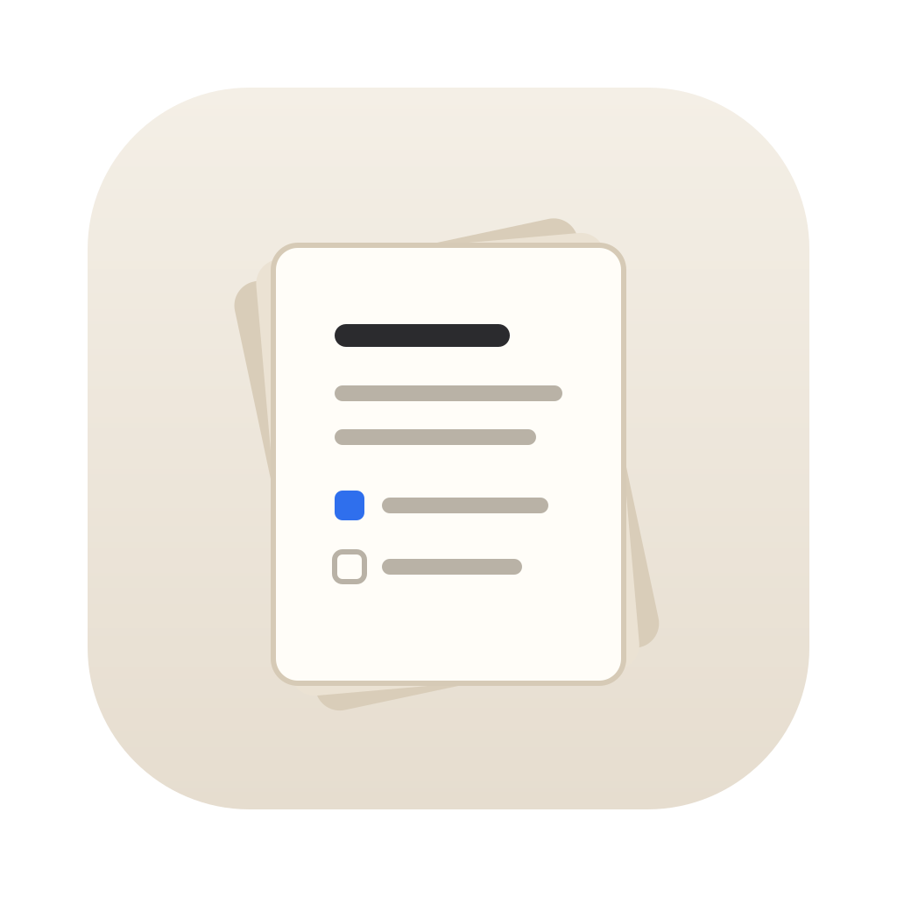

<p align="center"></p>

# Sheaf

Notes, tasks and daily planning in one place. Open source, local first, on every platform.

- **Today**: every day gets its own note. Unfinished tasks move to the next day with one click.
- **Documents**: give each project its own page, with subpages, photos, files and tables.
- **Links**: type `@` to link a document or a date. Every page shows where it was mentioned, and a click jumps to that exact line.
- **Templates**: save any page as a template and start new ones from it.
- **PDF**: export any page.

Your notes are plain JSON files in `Documents/Sheaf`, so you can sync them with iCloud, Dropbox, Syncthing or git. No account, no server.

## Get it

- **macOS, Windows, Linux**: [latest release](https://github.com/isaaclins/sheaf/releases/latest)
- **iPhone, Android, any browser**: [isaaclins.github.io/sheaf](https://isaaclins.github.io/sheaf/) (add it to your home screen; notes stay in that browser)

## Build it

```sh
npm install
npm run tauri dev     # desktop app
npm run dev           # browser version
npm run tauri build   # installer for your platform
```

Built with [Tauri](https://tauri.app) and [BlockNote](https://www.blocknotejs.org).

## License

MIT
